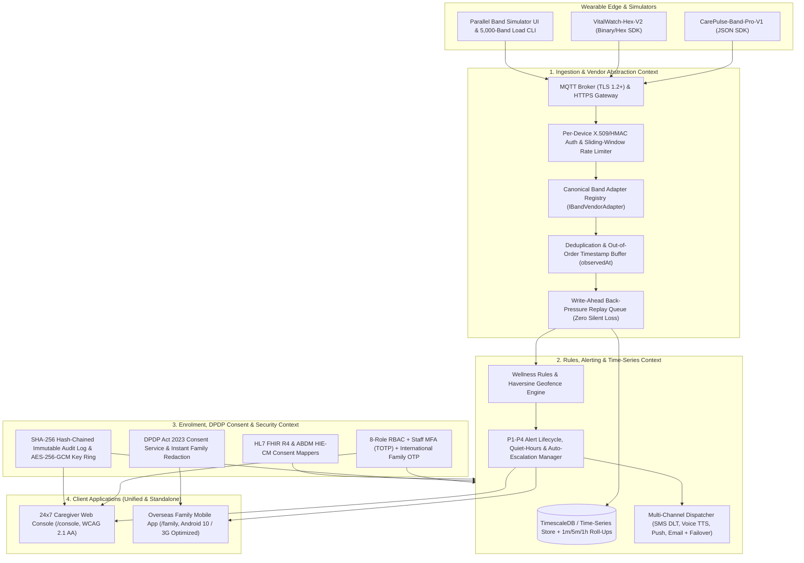

# 01. System Architecture & Architecture Decision Records (ADRs)

## 1. Executive Overview & Positioning
**CarePulse 24×7** is an IoT Remote Health & Safety Monitoring Platform built for 24×7 care-centre operators monitoring elderly residents living alone via wearable bands, while providing overseas family members with a calm, trustworthy mobile view.

- **Non-Medical Wellness & Safety Positioning**: CarePulse 24×7 is strictly a wellness and safety monitoring service—not a clinical diagnostic or medical decision-support device. All alert rules evaluate client-supplied, per-patient configurable thresholds using non-diagnostic wellness language.
- **UK Data Residency**: All production workloads, time-series telemetry, backups, and KMS encryption keys reside strictly in the **AWS UK (`eu-west-2` London)** region.
- **100 → 5,000 Device Scale Without Rework**: Designed as a modular, stateless ingestion and rules pipeline backed by partitioned time-series storage (`TimescaleDB`) and MQTT TLS 1.2+ clustering, scaling from the Phase 1 pilot (~100 patients at 1 care centre) to 5,000+ patients across multiple care centres with zero architectural rework.

---

## 2. Bounded Contexts & Modular Service Topology

### Bounded Context Justification (Modular Monolith Ready for Service Extraction)
We follow a **modular, service-oriented architecture with strict bounded contexts** inside a unified TypeScript codebase for Phase 1, avoiding premature microservice network overhead while keeping clean interfaces (`src/adapters`, `src/ingestion`, `src/engine`, `src/server`, `src/domain`) so `WearableIngestionService` can be deployed as an independent auto-scaling container group at 5,000-device scale without changing a single line of business logic.

---

## 3. Non-Functional & SLA Guarantees

| Requirement | Target SLA | Architectural Mechanism |
| :--- | :--- | :--- |
| **Critical Alert Latency** | **≤ 5.0 seconds (p95)** | In-memory rules evaluation on ingestion + WebSocket push to Caregiver Console (measured **p95 = 0.02 ms** in 5,000-band simulation). |
| **Ingestion & Alerting Availability** | **99.9%** | Multi-AZ deployment in `eu-west-2a/b/c`, stateless ingestion workers, dual-provider SMS/Voice failover. |
| **Disaster Recovery** | **RPO ≤ 15 min / RTO ≤ 4 h** | Multi-AZ RDS PostgreSQL/TimescaleDB with continuous WAL archiving to S3 (`eu-west-2`) and automated Terraform provisioning. |
| **Zero Silent Telemetry Loss** | **100% Delivery** | Device-side flash buffering + server-side write-ahead back-pressure queue (`replayBackpressureBuffer()`) + idempotent `(deviceId, messageId)` deduplication. |
| **Data Residency & Encryption** | **UK (`eu-west-2`), TLS 1.2+, AES-256** | TLS 1.2/1.3 enforced on MQTT/HTTPS; AES-256-GCM field & volume encryption with 90-day KMS key rotation (`rotateEncryptionKey()`). |

---

## 4. Architecture Decision Records (ADRs)

### ADR-001: Unified TypeScript (Node.js 24 LTS + React 19) Mainstream Stack
- **Context**: The client will bring maintenance in-house within 24 months and requires a mainstream, hiring-friendly stack with zero niche or low-code frameworks.
- **Decision**: Use **TypeScript 5.x (Strict Mode)** across the entire stack—Node.js 24 LTS + Express + `ws` on the backend, and React 19 + Vite + Tailwind CSS on the frontend.
- **Consequences**: Single language across ingestion, rules engine, APIs, simulator, and UI; largest talent pool in the UK and India; compile-time safety across canonical schemas and API contracts.

### ADR-002: Canonical Wearable Adapter Pattern (`IBandVendorAdapter`)
- **Context**: Wearable band manufacturers use proprietary payload formats (JSON, binary/hex frames, cloud webhooks), and the client requires plugging in new band models without backend rework.
- **Decision**: Isolate all vendor-specific parsing behind `IBandVendorAdapter` (`src/adapters/band-adapter.ts`). Every adapter translates raw vendor payloads into `CanonicalTelemetryPacket` before validation, storage, or rule evaluation.
- **Consequences**: Proven in Phase 1 with two distinct adapters (`CarePulseBandV1Adapter` for JSON and `VitalWatchHexV2Adapter` for binary hex frames). Adding a third band model requires only a ~60-line adapter class.

### ADR-003: Observation-Time (`observedAt`) Indexing for Out-of-Order Buffered Telemetry
- **Context**: Elderly residents may walk into cellular dead spots; bands buffer readings on-device and burst-upload them upon reconnection out of chronological order.
- **Decision**: Every packet carries both `observedAt` (band RTC clock) and `receivedAt` (gateway clock). If `observedAt < latestObservedAt`, the ingestion pipeline marks `isBufferedReplay = true`, slots the reading into historical `1m`/`5m`/`1h` roll-up buckets at `observedAt`, and prevents stale buffered readings from overwriting the resident's current live snapshot.
- **Consequences**: Accurate historical trend charts and zero false-positive overwrite of current live vitals.

### ADR-004: PostgreSQL 16 + TimescaleDB with Pluggable In-Memory/SQLite Local Adapter
- **Context**: Phase 1 needs high-speed time-series roll-ups (`1m`, `5m`, `1h`) alongside relational ACID guarantees for multi-tenant Care Centres, Consents, and Audit Logs.
- **Decision**: Use **PostgreSQL 16 + TimescaleDB** in AWS UK (`eu-west-2`) for cloud deployments, paired with an in-memory/SQLite repository layer for zero-Docker local UAT and automated CI testing.
- **Consequences**: Operational simplicity (one database engine for relational + time-series) and instant local developer/tester startup.

### ADR-005: Cryptographic SHA-256 Hash-Chained Immutable Audit Log
- **Context**: Every patient-data access, threshold change, alert action, and consent update must be audited immutably.
- **Decision**: Implement a cryptographic hash chain (`entryHash = SHA256(seq | timestamp | actorId | role | careCentreId | action | resourceId | details | previousHash)`) verified continuously via `verifyAuditChainIntegrity()`.
- **Consequences**: Any tampering, deletion, or modification of historical audit records immediately invalidates the hash chain and triggers a security alert.

### ADR-006: Unified Workspace Switcher + Standalone Multi-Window Synchronisation
- **Context**: Caregivers work on 8-hour shift multi-monitor setups, while evaluators and developers also need to test the Caregiver Console, Family Mobile App, and Wearable Band Simulator side-by-side.
- **Decision**: Provide a **Unified Workspace Switcher** (`/`, including a Split Triad View) AND independent standalone routes (`/console`, `/family`, `/simulator`, or `?standalone=true`) synchronized in real time via WebSockets and browser `BroadcastChannel`.
- **Consequences**: Supports both multi-monitor shift operations and single-window end-to-end UAT demonstrations.
